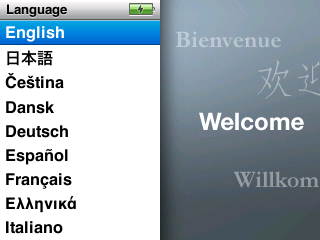
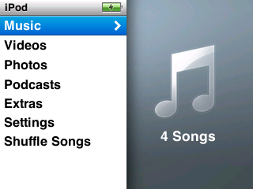
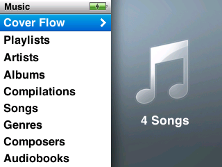
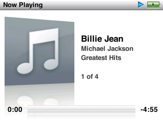

# iPod classic 6G in QEMU

This fork of [qemu-ipod-classic](https://github.com/davidmonterocrespo24/qemu-ipod-classic) is specifically for running iPod Classic 6th generation (and pseudo-7th generation) firmware.

|  |  |  |
| -- | -- | -- |
|  |  |  |
| Language screen | Main menu | Music menu |
|  |  |  |
| Playback (mostly) works |  |  |

## Getting the firmware

Firmware images can be found at [The Apple Wiki](<https://theapplewiki.com/wiki/Firmware/iPod#iPod_classic_(6th_generation)>), but newer iPod Classic `osos` firmware file is encrypted and must be decrypted before use (e.g. with [wInd3x](https://github.com/freemyipod/wInd3x) or on-device under emCORE).

| Device | Path | Reference |
| -- | -- | -- |
| Classic 6G | Keep the `.ipsw` (it also builds the disk). Extract `osos` from it, then have the device decrypt it with its own GID key under emCORE (1.2 s over USB) | [`docs/ipod/how-to/decrypt-classic-firmware.md`](docs/ipod/how-to/decrypt-classic-firmware.md) |
| Video 5G | Unencrypted; dump the firmware partition (`tools/ipod_video/dump-firmware.ps1`) from a Rockbox dual-boot iPod | [`docs/ipod/how-to/run-an-ipod-video.md`](docs/ipod/how-to/run-an-ipod-video.md) |

## Building and running

This repository uses the QEMU project as its base and can be built like such, but this iPod fork adds [Docker](https://docs.docker.com/engine/install/) for build and execution convenience. Optionally, [mise](https://mise.jdx.dev) can be used to run tasks and manage environment variables.

This assumes you are using Linux, or at least an X server (or X compatibility shim, if on Wayland) is available if you want to run the emulator in a visible window.

**With mise:**

Mise wraps `scripts/` and declares task dependencies.

```sh
mise run docker:build-images     # once: the qemu-ipod-dev and qemu-ipod-build images
mise run build-in-docker         # configure (first time) and build build/qemu-system-arm
mise run ipod:make-disk -- --firmware=path/to/iPod_38.2.0.5.ipsw --disks=path/to/disk.qcow2  # once: an empty disk
mise run ipod:run -- --osos=path/to/osos_decrypted.bin --disks=path/to/disk.qcow2  # boot in a visible SDL window (needs an X display)
mise run ipod:run -- --headless --timeout=30 --osos=... --disks=...  # no window: boot for 30 s (default 0 = no limit)
```

**Without mise:**

Execute scripts directly.

```sh
scripts/docker/build-dev-image   # once: the qemu-ipod-dev and qemu-ipod-build images
scripts/docker/build-build-image
scripts/build-in-docker          # configure (first time) and build build/qemu-system-arm
scripts/ipod/make-disk --firmware=path/to/iPod_38.2.0.5.ipsw --disks=path/to/disk.qcow2  # makes an iPod-compatible disk image. Requires the dev Docker container. Wraps tools/ipod_classic/make_disk.py, which can be used directly as well
scripts/ipod/run --osos=path/to/osos_decrypted.bin --disks=path/to/disk.qcow2  # boot in a visible SDL window (needs an X display)
scripts/ipod/run --headless --timeout=30 --osos=... --disks=...  # no window: boot for 30 s (default 0 = no limit)
```

Emulation startup requires both an unencrypted Apple firmware blob (`osos` image) and iPod compatible disk image, which can be generated using `make-disk` and the encrypted firmware blob.

Default boot options can be configured via environment variables, optionally via `mise.local.toml`.

```toml
[env]
OSOS = "assets/firmware/osos_decrypted.bin"
DISK = "assets/disks/ipod-disk.qcow2"
FIRMWARE = "assets/firmware/iPod_38.2.0.5.ipsw"   # creates DISK on first run
```

| Variable | Argument | Effect |
| -- | -- | -- |
| `OSOS` | `--osos=PATH` | Decrypted `osos` to boot (see [Getting the firmware](#getting-the-firmware)); required |
| `DISK` | `--disks=PATH` | Disk image, qcow2 or raw; required |
| `FIRMWARE` | `--firmware=PATH` | `.ipsw` or `Firmware-XX` payload; if `DISK` is missing, `ipod:make-disk` creates it from this ([Disk and firmware tasks](#disk-and-firmware-tasks)) |
| `T` | `--timeout=SECS` | Run time limit in seconds; default 0 (no limit) |

Other arguments to `ipod:run` are passed to QEMU (under mise, after `--` if they start with `-`). Run other commands in the dev container with `docker run --rm -i --user $(id -u):$(id -g) -v $PWD:$PWD -w $PWD qemu-ipod-dev <cmd>`. Screenshots, keys, gdb, tracing and snapshots: [`docs/ipod/how-to/debug-a-classic-guest.md`](docs/ipod/how-to/debug-a-classic-guest.md).

### Disk and firmware tasks

Besides `ipod:run`, `scripts/ipod/` has one task for preparing a disk (`mise tasks` lists everything). Like `ipod:run`, it takes `--name=value` or `name=value` flags, each with an environment variable as its default; flags win. Relative paths are from the repository root, and no task assumes where you keep files.

`--firmware` is an Apple `.ipsw` or its bare `Firmware-XX` payload (accepted inputs: `tools/README.md`). To inspect or extract firmware, run `fwtool.py` directly (commands: `tools/README.md`).

#### `scripts/ipod/make-disk`

Creates a bootable disk, thin-provisioned qcow2, for `ipod:run`: empty, or with a one-track library when `--track` is given.

| Flag | Env | Meaning |
| -- | -- | -- |
| `--firmware=PATH` | `FIRMWARE` | The firmware to build the disk around |
| `--disks=PATH` | `DISK` | Disk to create |
| `--track=PATH` | `TRACK` | Optional: put a one-track library on the disk (`portblue` for the shipped AAC fixture, or any audio file; `tools/README.md`) |

The script behaves as follows:

- If the disk file already exists, the script leaves it unchanged. To build a new disk, delete the file first.
- If no flags are given and `FIRMWARE` is not set, the script does nothing and reports that. This allows `ipod:run`, which depends on the `ipod:make-disk` task, to proceed when you supply your own disk.
- `ipod:run` also calls the script when the disk named by `DISK` does not exist and a firmware was supplied (`--firmware` or `FIRMWARE`).

The script runs `tools/ipod_classic/make_disk.py` in the `qemu-ipod-dev` container, which provides the tools it needs. What it builds, and how it reads the firmware, is described in `tools/README.md`.

`ipod:run` boots with QEMU's `-snapshot`, so guest writes go to an overlay and never reach the disk file.

### Emulator input methods

| Key | Button |
| -- | -- |
| `q` / `e` (or mouse scroll on the classic) | wheel anticlockwise / clockwise |
| `Enter` | SELECT |
| `w` | MENU |
| `a` / `d` | previous / next |
| `s` | PLAY / PAUSE |

## Testing

iPod Classic tooling tests are in `tools/ipod_classic/tests/` and run under `pytest`:

```sh
mise run check:tests                 # all tests; the docker end-to-end ones skip without docker. Alternatively, scripts/check/tests
mise run check:tests -- -k version   # extra arguments are passed to pytest
```

The Docker end-to-end tests (`tests/test_make_disk.py`) skip unless `docker`, the `qemu-ipod-dev` image and `build/qemu-img` are present. The real-firmware test additionally needs an Apple `.ipsw` under Apple's file name `iPod_<family>.<version>.ipsw`, at `assets/test/iPod_38.2.0.5.ipsw` (or wherever `IPOD_TEST_IPSW` points).

## Limitations

**iPod Classic 6G**

- The SM1 audio engine decodes AAC only (libavcodec); other codecs are not wired.
- No USB, NAND, CE-ATA or AES.

## Additional iPod-related documentation

| Kind | Document | Contents |
| -- | -- | -- |
| How-to | [`docs/ipod/how-to/decrypt-classic-firmware.md`](docs/ipod/how-to/decrypt-classic-firmware.md) | `.ipsw` to `osos_decrypted.bin` with emCORE |
| How-to | [`docs/ipod/how-to/debug-a-classic-guest.md`](docs/ipod/how-to/debug-a-classic-guest.md) | Boot, screenshots, keys, memory, gdb, pctrace, audio capture, snapshots |
| How-to | [`docs/ipod/how-to/run-an-ipod-video.md`](docs/ipod/how-to/run-an-ipod-video.md) | 5G firmware dump, disk build, boot, evidence scripts |
| Reference | [`hw/arm/ipod_classic/README.md`](hw/arm/ipod_classic/README.md) | S5L8702 memory map, device models, audio and video pipelines, environment variables, snapshot contract |
| Reference | [`hw/arm/ipod_video/README.md`](hw/arm/ipod_video/README.md) | PP5022 memory map, BCM/VideoCore interface, assumptions and deviations |
| Reference | [`docs/ipod/classic6g-firmware.md`](docs/ipod/classic6g-firmware.md) | `.ipsw`/`]ih[`/IM3 formats, emCORE decrypt, NOR layout, what cannot be dumped |
| Reference | [`tools/README.md`](tools/README.md) | Tools in this tree |

## External and upstream resources

Forked from [davidmonterocrespo24/qemu-ipod-classic](https://github.com/davidmonterocrespo24/qemu-ipod-classic), itself a fork of [devos50/qemu-ios](https://github.com/devos50/qemu-ios) (QEMU 8.2.0, branch `ipod_touch_2g`), which emulates the **iPod Touch 1G and 2G**.

- [Running the iPod Touch 1G](https://devos50.github.io/blog/2022/ipod-touch-qemu-pt2/) and the [technical write-up](https://devos50.github.io/blog/2022/ipod-touch-qemu/).
- [Running the iPod Touch 2G](https://github.com/devos50/qemu-ios/blob/ipod_touch_2g/RUNNING.md).

QEMU's own documentation is in [`docs/`](docs/).

This work also depends on: **Rockbox** (register-level drivers for both devices: `firmware/target/arm/s5l8702/` and `firmware/export/s5l87xx.h` for the classic, `firmware/target/arm/ipod/` and `pp5020.h` for the 5G), **iPodLinux** (`ipodloader2/ipodhw.c`, the SysInfo block), **ipodpatcher** (the dual-boot layout) and **[freemyipod.org](https://freemyipod.org/wiki/Classic_6G)** (emCORE, and a QEMU model of the S5L8702 in `freemyipod/qemu@s5l8702-dev`).
