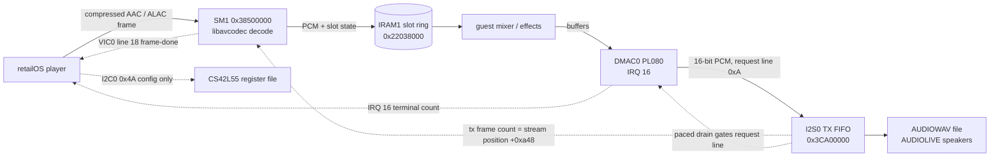
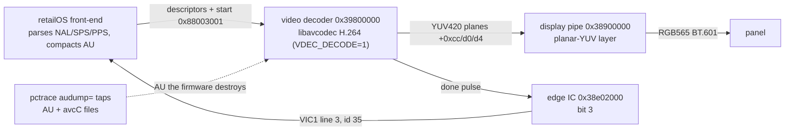

# iPod classic 6G (S5L8702) — `-M iPod-Classic`

Reference for the 6G machine: hardware, device models, environment variables, snapshot contract. Task steps for debugging a guest: `docs/ipod/how-to/debug-a-classic-guest.md`. Guest VAs are 2.0.5 runtime addresses; `file_off = VA - 0x07FF5068`. Register-level detail and its evidence live in each device's header under `include/hw/arm/ipod_classic/`. Firmware format and the real device: `docs/ipod/classic6g-firmware.md`.

## Board

| Part | Chip | Notes |
| -- | -- | -- |
| SoC | Samsung S5L8702 (Apple `337S3473`) | ARM926EJ-S, 216 MHz |
| SDRAM | K4X51163PE | 64 MB |
| NOR | SST25VF080B, SPI0 | 1 MiB: SysCfg, NOR boot IM3, `flsh` files (`docs/ipod/classic6g-firmware.md`) |
| PMU | NXP PCF50635, I2C0 `0x73` (8-bit `0xE6`) | also RTC, ADC, backlight, hold switch (GPIO2) |
| Codec | Cirrus Logic CS42L55, I2C0 `0x4A` (8-bit `0x94`) | reset on GPIO 3.3 |
| "Mikey" | I2C0 `0x39` (8-bit `0x72`) | headphone mic / inline remote, not the wheel; not modelled |
| Storage | 1.8" PATA HDD, ATA at `0x38700000` | CE-ATA over SDCI is the other strap (`PDAT(11) & 2`); only PATA is modelled |
| Panel | 320×240 RGB565, MPU/8080 interface | four panel types, `PDAT6[5:4]` (`LCDTYPE`) |
| Charger | LTC4066 |  |

Clocks: OSC0 12 MHz, OSC1 32768 Hz (from the PMU), UNKOSC 24 MHz, ECLK 12 MHz (timer reference). Rockbox's plan: CClk 216, HClk 108, PClk 54, SM1Clk 27 MHz.

## Memory map

Sources:

- Rockbox `firmware/export/s5l87xx.h` preprocessed for `CONFIG_CPU==S5L8702`
- freemyipod
- Apple's code for remaining blocks.

`s5l87xx.h` is Rockbox's register header, shared by the S5L8700, the [S5L8701](https://theapplewiki.com/wiki/S5L8701) (iPod nano 2G), the [S5L8702](https://theapplewiki.com/wiki/S5L8702) (this machine; also the nano 3G) and the S5L8720. Where the chips differ, `CONFIG_CPU` conditions select each chip's address, so preprocessing for `CONFIG_CPU==S5L8702` picks the 8702 values. Some addresses are not selected that way. `INT_BASE`, `RTC_BASE`, `ADC_BASE`, `USB_HC_BASE` and `USB_FC_BASE` are defined for every chip, so they appear in the 8702 build even though the 8702 has different blocks at those addresses (listed after the tables below). Everything below is the S5L8702 layout.

| Region | Base | Size |
| -- | -- | -- |
| SDRAM (cached) | `0x08000000` | 64 MB |
| SDRAM (uncached alias, bit 31) | `0x88000000` | 64 MB. The guest programs DMAC0 with the cached view and runs on the uncached one, and hands SHA-1 uncached addresses |
| IRAM0 | `0x22000000` | 128 KB; also aliased at `0x0`, where the ARM926 takes exceptions |
| IRAM1 | `0x22020000` | 128 KB (64 KB on the S5L8720); last 256 B at `0x2203FF00` = boot info block |
| Bootrom | `0x20000000` | 50 or 64 KiB (unreconciled); locked after boot, no dump exists |
| Peripheral window | `0x38000000`..`0x3FFFFFFF` | the retailOS maps all of it uncached, so an unmapped address is a data abort: an `-d unimp` floor sits under the whole window |

| Base | Block | IRQ | Model |
| -- | -- | -- | -- |
| `0x38000000` | SHA-1 | 40 | `ipodtouch.sha1` (same register map); `SHA1_OFF` = stub |
| `0x38100000` | MIU |  | unimp |
| `0x38200000` | DMAC0 (PL080) | 16 | `hw/dma/pl080.c`, 4 KB window, system memory as master port |
| `0x38300000` | LCD interface + panel | 14 | `ipod_classic_lcd.c` |
| `0x38400000` | USB OTG (DWC) | 19 | unimp |
| `0x38500000` | SM1 audio engine | 18 | `ipod_classic_sm1.c` (Media pipelines → Audio) |
| `0x38700000` | ATA | 29 | `ipod_classic_ata.c`: Apple's bridge (a register read starts a cycle; result in `ATA_PIO_RDATA`), PIO + flat DMA |
| `0x38900000` | display pipe / compositor |  | `ipod_classic_disp.c`. Not in any public source; map from Apple's code (`ipod_classic_disp.h`) |
| `0x38A00000` | NAND/FMI (`ATA_UNKNOWN_BASE`) | 20 | unimp; `+0x2000` NAND ECC |
| `0x38B00000` | SDCI (CE-ATA) | 44 | unimp |
| `0x38C00000` | AES (bus master) | 39 | unimp |
| `0x38E00000` | VIC0 / VIC1 (`+0x1000`), PL192 |  | `hw/intc/pl192.c`; the retailOS dispatcher at `0x22004DA0` reads both banks with no cross-condition |
| `0x38E02000` | edge IC |  | `ipod_classic_edgeic.c`: per-source rising-edge latch, `+0x4` enable, `+0xc` W1C; bit 3 = video decoder done → VIC1 line 3 (35) |
| `0x39000000` / `0x3F000000` | CalmADM2E DSP SFR / data |  | unimp. The retailOS never touches either (its `0x3F000000` literals are `0.5f`) |
| `0x39300000` | display/scaler output (SDO) | 30 | `ipod_classic_sdo.c`: frame-done edge, `+0x280` ack, `SDO_FRAME_IRQ=1` (default off) |
| `0x39600000` | JPEG decoder |  | not mapped (floor) |
| `0x39800000` | video decoder | 35 | `ipod_classic_vdec.c` (Media pipelines → Video) |
| `0x39900000` | DMAC1 (PL080) | 17 | `hw/dma/pl080.c` |
| `0x39A00000` | EIC (7 groups × 32; groups → IRQ 0-3, 31-33) |  | unimp; the guest programs it, nothing fires. GPIO pin `n` is group `6 - (n>>5)`, bit `(0x18 - (n & 0x18)) \| (n & 7)`. Group 0: bit 0 = "alive" timer end, bit 2 = USB cable |
| `0x3C100000` | RNG (inferred) |  | `ipod_classic.c`: LCG, `+0` ready `[2:0]` (no enable bit: gating it hangs), `+4` data, `+8` seed. Only reached diskless |
| `0x3C200000` | click wheel | 23 | `ipod_classic_wheel.c` |
| `0x3C300000` | SPI0 (NOR) | 9 | not mapped (floor); SPI1 `0x3CE00000`, SPI2 `0x3D200000` |
| `0x3C400000` | USB PHY |  | unimp |
| `0x3C500000` | clock / PLL |  | `ipod_classic_clk.c`: `PLLLOCK` reports enabled PLLs locked, `SWRCON` reboots, sub-word access |
| `0x3C600000` | I2C0 | 21 | `ipod_classic_i2c.c` + PMU + CS42L55 (Audio). I2C1 at `0x3C900000` (22), not modelled |
| `0x3C700000` | timers | 8 (A-D), 7 (E-H) | `ipod_classic_timer.c`, interval mode only |
| `0x3C800000` | WDT |  | unimp |
| `0x3CA00000` | I2S0 |  | `ipod_classic_i2s.c` (4 KB window; Media pipelines → Audio); I2S1 `0x3CD00000`, I2S2 `0x3D400000` |
| `0x3CB00000` | S/PDIF |  | unimp |
| `0x3CC00000` | UART, 4 ports, stride `0x4000` | 24-27 | port 0 only, `hw/char/exynos4210_uart.c`; on the dock connector (iAP by default) |
| `0x3CF00000` | GPIO, 16 groups × 8, stride `0x20` |  | `ipod_classic_gpio.c`: pin 86 = media present (`GPIO_MEDIA`), `LCDTYPE` straps; rest read 0 |
| `0x3D100000` | chip ID |  | unimp |

The table's "unimp" entries are `create_unimplemented_device()` windows; "floor" is the window-wide `s5l8702.io` region. Both log under `-d unimp` and read 0.

Names in Rockbox's header that do not describe the same block at that address on the S5L8702 (`SPI_BASE` and `FMC_BASE` are conditional on the S5L8700/8701; the rest are defined for every chip):

| Rockbox name | Address | On the S5L8702 |
| -- | -- | -- |
| `SPI_BASE` | `0x3CD00000` | I2S1. SPI0 is `0x3C300000`, SPI1 `0x3CE00000`, SPI2 `0x3D200000` (`SPIBASE(i)`) |
| `ADC_BASE` | `0x3CE00000` | SPI1. The ADC is inside the PMU |
| `RTC_BASE` | `0x3D200000` | SPI2. The RTC is the PCF50635's |
| `FMC_BASE` | `0x39400000` | NAND is at `0x38A00000` (Rockbox's `ATA_UNKNOWN_BASE`) |
| `MS_BASE` | `0x3C600000` | I2C0. The memory-stick block is legacy |
| `INT_BASE` | `0x39C00000` | The legacy interrupt unit is replaced by the two PL192s |
| `USB_HC_BASE`, `USB_FC_BASE` | `0x38600000`, `0x38800000` | Not used; USB is the OTG block at `0x38400000` |

The model maps none of these as devices; an access falls to the `s5l8702.io` floor. Where freemyipod's QEMU fork disagrees with Rockbox, this model follows Rockbox, which runs on the hardware: the fork puts the EIC groups on IRQ 9-15 (Rockbox: 0-3, 31-33) and I2C1 at `0x3C610000` (Rockbox: `0x3C900000`, `IICCON(bus) = IIC_BASE + 0x300000*bus`).

Boot without a bootrom: `-kernel` loads the raw `osos` at `0x08000000` and the machine writes the boot info block (`BOOTINFO`, `FWGUID`). For a Rockbox app image it also reproduces the bootloader hand-off (`ipod_classic_handoff`): SP at the top of IRAM0 and timer E at 1 MHz, since `crt0.S` calls `memory_init` before setting stacks and `udelay` spins on `TECNT`. Semihosting is on by default: the retailOS prints its panics through it (stderr).

Not modelled: USB, NAND/ECC, CE-ATA/SDCI, AES, the DSP, EIC, SPI/NOR, S/PDIF, WDT, chip ID, Mikey, I2C1, UARTs 1-3, the bootrom.

### Open hardware questions

| Question | Status |
| -- | -- |
| Bootrom size (50 vs 64 KiB) and the register that remaps `0x0` (ROM → IRAM0) | unknown; the model keeps the IRAM0 alias at 0 unless `-M ...,bootrom=` is given |
| What GPIO pin 86 is on the board | its role in Apple's firmware is verified, the board net is not |
| `WHEELCON` bits, `WHEELDIV` `0x3A980`, `WHEELPEND`/`WHEELMASK` bits 1-2, why both `WHEELTX` encodings work | unknown, not needed |
| LCD `+0x7C`, `+0x88`; whether `+0x70` latches a frame or enables the scan; `LCD_STATUS` bits 2 and 8 | unknown |
| The rest of the `0x38900000` map | only what the image and `DISPTRACE=1` show |
| Part numbers of the four panels; UART2/3 pin mux; a PKE block at `0x3D000000` | unknown |

## Media pipelines

The retailOS decodes neither audio nor video in software. It hands each compressed frame to a hardware block (SM1 for audio, `0x39800000` for video) and reads the result back, so the models stand in for those blocks and the guest's own mixer, effects, output queue and display pipe run unchanged. Each pipeline below has the same shape: what the guest and the model exchange, the environment variables, and the one known limit. Register-level detail lives in the device headers under `include/hw/arm/ipod_classic/`.

### Audio

The codec chip is only configured over I2C, never in the sample path. The dashed edges are the model's feedback loops: the I2S sample count becomes SM1's stream position, and the I2S drain rate gates DMAC0, which together keep the Now Playing clock at playback tempo.

| Interaction point | Guest does | Model does |
| -- | -- | -- |
| SM1 identity | Reads `+0xc80` and compares with `0x004e7309`; a mismatch spins forever | Returns the magic |
| Channel power-up | Per sub-block (base + `idx*0x20` for idx < 4, `0x100`/`0x180`/`0x200`/`0x230` for 4..7): writes 4 to `+0x10`, polls `+0x14 & 7` up to ten times for 7, writes 16. A poll that never reads 7 is recorded as an error (−236), not a hang | `+0x14` reads 7 once `+0x10` has been written |
| Clock ready | Spins on `+0xa98` bit 2 with no timeout; start/resume is gated on it | Raises the bit when the guest first powers the engine (a channel command, the codec enable `+0x824`, the `+0x400` start or the `+0xc48` commit) |
| Run | Writes 1 to `+0x400`, reads it back expecting 1, then polls `& 3` for 1 with no timeout | Plain write latch |
| Frame submit | Sub-block 4: chain at `+0x100`, descriptor `{0, len<<16\|flags, buf}`. Enable word `0x2203ff00 & 7 == 7`; sample-rate index at `+6` | Decodes the frame with libavcodec (`ipod_classic_sm1_dec.c`: AAC and ALAC, see [Codecs](#codecs); built when `-Dsm1_decoder=auto` finds libavcodec) |
| Output slots | Reads PCM and state from IRAM1 (two slots of 4096 halfwords; ALAC one of 8192): header `0x2203ff28`, slots `0x22038000` (count `+2`, stride in halfwords `+4`, per-slot state `+0xa` and size `+0xc`), buffers `0x22038100` | Writes the decoded PCM and slot state there |
| Frame-done IRQ | VIC0 line 18 handler acks through `+0xc48` | Holds the line until the ack. Raised on the guest's arming write, an approximation |
| Stream position | Reads `+0xa44`/`+0xa48` (four channels, stride `0x14`) and uses the value as a ring offset: write pointer = `0x22020000 + pos*4` | I2S transmitted stereo frames, wrapped at 22×1024 frames so the guest's writes stay below the slot area (a model choice; the real ring size is unknown) |
| I2S0 setup | Writes `CLKCON`=1, `TXCON`=`0x0b100019`, `RXCON`=`0x1000`, `CLKDIV`=272, `TXCOM`=6 (start), then reads `TXCOM` back | Register file with honest readback. Sample rate = 12 MHz / `CLKDIV` |
| PCM out | DMAC0 streams 16-bit samples to the TX FIFO at `+0x10` (DMA request line `0xA`); its terminal-count IRQ paces the player | FIFO sink. The paced drain gates DMAC0's request line at the sample rate, so the IRQ arrives at playback tempo and the Now Playing clock advances. Unpaced, the DMA never moves and the stream position stays 0 |
| Codec | CS42L55 at I2C0 `0x4A`: write the register number, then data; read-modify-write | Register file with an auto-advancing pointer and the chip-version register. No audio path behind it |

#### Codecs

The guest's setup routine (`pcm_push`, `0x0809a898`) switches on a codec byte (values 0, 1, 3, 5 and 7 have branches) and fills the control block at `0x2203ff00`. The model decodes the codecs it has measured, told apart by the enable word:

| Codec | Enable word `&7` / `&0x1e` | Control block | Slot ring | Verified |
| -- | -- | -- | -- | -- |
| AAC (LC) | 7 / `0x0e` (`0x2d2f`) | `+6` = MPEG-4 frequency index | 2 slots × 4096 halfwords | Bit-identical to ffmpeg |
| MP3 (CBR and VBR) | 5 (`0x2d2d`) | none (zero) | 2 slots × 4096 halfwords | Bit-identical to ffmpeg (encoder delay trimmed by ffmpeg, not by the guest) |
| ALAC | 7 / `0x1e` (`0x2d3f`) | `+4` bit depth, `+6` pb, `+8` kb, `+0xa` mb (the magic cookie's values) | 1 slot × 8192 halfwords | 16-bit: bit-identical to ffmpeg; 24-bit: within 1 LSB (rounding to 16 bits) |

An ALAC packet (4096 stereo frames, about 8 to 14 KiB compressed) is handed over whole, and its decode is 8192 halfwords. The guest counts every frame-done report as one packet consumed, so the packet has to leave in a single slot (splitting it across reports made the guest feed the next packet early and the model drop it). Two such slots would not fit IRAM1 below the control block, so the ring has one slot. The silicon's 24-bit-to-16-bit reduction is not known; the model rounds. The guest hands MP3 over as one raw frame (417 or 418 bytes at 128 kbit/s) per chain, including a VBR file's first (Xing) frame. WAV and AIFF never reach SM1: the guest turns them into PCM itself, and the capture is bit-identical to the source. HE-AAC and Audible are not modelled or measured: no encoder for them is available in the dev image (its libfdk-aac is built without SBR) and there is no Audible encoder at all. Any other enable word logs `SM1: codec enable word ... not modelled` under `-d unimp`.

| Variable | Default | Meaning |
| -- | -- | -- |
| `SM1=0` | on | Master off: SM1 blocks fall back to the register-only model |
| `SM1_DECODE=0` | on when built with libavcodec | Skip the decode (no effect with `SM1=0`) |
| `SM1_IRQ=0/1/2` | 1 | Frame-done IRQ: off, guest-armed, pulse regardless of arming |
| `SM1_IRQ_EVERY=N` | 5 | 5 ms ticks between reports |
| `SM1_POS=N` | ring wrap | Override the position ring wrap (0 pins it at the ring base) |
| `SM1_SLOTS=1`, `SM1_NSLOTS=N` | off, 2 | DEV TOGGLE: publish invented slot geometry in IRAM1 without PCM. 7 of 2048 frames claims 28 KiB and stomps IRAM1 |
| `SM1_FRAME_BIT=1` | off | Also report status bit 12 while a report is pending (experiment) |
| `SM1_DEC_DUMP=file`, `SM1_DEC_DUMP_FRAMES=file` | unset | Dump decoded s16le PCM / the submitted frames (the frames file needs `SM1_DEC_DUMP` too) |
| `SM1TRACE=1`, `SM1HI=1` | off | Per-access log / count writes above the modelled 4 KiB page |
| `AUDIOPACE=0` | paced | Un-paced I2S drain (baseline) |
| `AUDIOWAV=/path.wav` | unset | Capture every PCM write to the I2S FIFO as 16-bit stereo WAV |
| `AUDIOLIVE=1` | off | Also play the FIFO through the active `-audiodev` |
| `I2SCOUNT=1`, `I2STRACE=1` | off | Write census / per-register trace |

Known limit: AAC is the only codec wired; the guest's enable word selects the others.

### Video

The guest parses the container, SPS/PPS and slice headers itself and compacts the access unit (AU) in place, stripping NAL and slice headers, so the block sees only entropy payloads and SPS/PPS never reach it.

| Interaction point | Guest does | Model does |
| -- | -- | -- |
| Context reset | Zeroes `+0x00..+0x12c` before every submit | Latches the zeros; `+0xf0`/`+0xf4` are device-owned (guest writes ignored), so done survives the reset |
| Frame submit | Writes the current Y/U/V plane addresses `+0xcc/+0xd0/+0xd4`, work buffer `+0xd8`, descriptor table `+0xdc` (8 words per slice: payload address at word 5, length at word 6), size `+0xe0` (`(H_MB<<8)\|W_MB`, 6 bits each), chroma/luma width `+0xe4` (role not fully known), count `+0xe8` (`(slices<<16)\|(2*W_MB*H_MB)`). Reference planes at `+0x00/+0x04/+0x08` and `+0x120/+0x124/+0x128`, flag `+0x12c` | Latches them. By default that is all (stub) |
| Start | ORs `0x88003001` into `+0xe8` | Clears `+0xf0`/`+0xf4`. Stub: nothing else, so the guest never sees done. `VDEC_DECODE=1`: decodes the AU with libavcodec H.264 and writes YUV420 to `+0xcc/+0xd0/+0xd4` (stride W for Y, W/2 for chroma) |
| Status | Polls `+0xf0` bit 0 (done) and `+0xf4` (success when bit 29 is clear and `(v & 0x1fffffff) >> 18 == 0`) | Only after a successful decode: `+0xf0` bit 0 set, `+0xf4` = 0. A read of `+0xf0` clears the done bit |
| Done IRQ | Line id 35 (VIC1 bit 3) via the edge controller: enables source bit 3 at `0x38e02000+0x4` (`0x0804b354`). The handler at `0x0804b36c` writes 8 to `0x38e02000+0xc` and signals an event; it never touches `+0xf0` | Pulses the line on done. `ipod_classic_edgeic.c` latches the edge (`+0x4` enable, `+0xc` write-1-to-clear) and drives VIC1 line 3. Without it a held line re-enters the handler forever |
| Display | Routine `0x081445cc` programs the display pipe: `+0x038` Y, `+0x03c` U, `+0x040` unused (0), `+0x044` V, `+0x030/+0x034` destination origin/limit | Converts to RGB565 (BT.601) behind the RGB layers. Only full-panel blits are rendered: the UI programs the same path with a 240×240 destination. Colour-matrix tables (`+0x0f0..`) are not decoded |

The firmware destroys the AU before submit, so `VDEC_DECODE=1` reads it from files written by the pctrace `audump=` tap (`contrib/plugins/pctrace.c`). Syntax `audump=PC:REG_BASE:OFF:REG_LEN:PATH`: at a TB head at `PC`, write `REG_LEN` bytes from `[REG_BASE+OFF]` to `PATH`.

| Tap | PC | Base | Offset | Length | Captured |
| -- | -- | -- | -- | -- | -- |
| Access unit | `0x081b6ee8` | `r1` | 0 | `r2` | front-end entry, before compaction |
| SPS/PPS config | `0x081b6cb8` | `r5` | 0 | `r6` | branch target in the stream setup (`0x081b6a80`) |

| Variable | Default | Meaning |
| -- | -- | -- |
| `VDEC_DECODE=1` | off | DEV SHORTCUT: decode the tapped AU instead of stubbing. Needs both files below and a libavcodec build (`-Dsm1_decoder`); otherwise it stays a stub |
| `VDEC_AU_FILE` | unset | Per-frame AU, 4-byte AVCC length-prefixed |
| `VDEC_CFG_FILE` | unset | AVCDecoderConfigurationRecord (avcC), prepended once |
| `VDECTRACE=1` | off | Log every decoder register access |
| `DISPLOG=1`, `DISPTRACE=1`, `SDOTRACE=1` | off | Trace the display path / the SDO block |
| `SDO_FRAME_IRQ=1` | off | Raise the display frame-done IRQ (line 30) from a timer; the guest acks at `0x39300000+0x280` |
| `SDO_FPS=N` | 60 | Frame rate of that timer |

Known limit: real playback decodes about 8 frames, then stops. The guest's present path waits on the display frame-done interrupt (VIC line 30, handler `0x0808b66c`); `SDO_FRAME_IRQ=1` raises it. The decode block is not the cause.

## Other models

| Area | File | What it does | Default |
| -- | -- | -- | -- |
| Edge interrupt controller | `ipod_classic_edgeic.c` | `0x38e02000`, behind the two VICs: latches a rising edge per source. Carries the video done line (see Video) | on |
| Compositor | `ipod_classic_disp.c` | Front-to-back `source-over` composition with the 32-bit layer's alpha channel | unset = on (`DISP_ALPHA=0` off) |
| LCD frame IRQ | `ipod_classic_lcd.c` | Pulses the frame-done interrupt at each frame. Partial: completes the NP entry animation, can starve the audio pump | unset = off (`LCD_FRAME_IRQ=1` on) |
| PMU charger | `ipod_classic_pmu.c` | Reports a charger present so retailOS does not show Low Battery. Model choice | unset = wall adapter (`PMUCHARGER=usb` / `none`) |

The defaults are the working combination: paced I2S, source-over compositing, wall adapter.

## Snapshots (savevm / loadvm)

The machine supports QEMU internal snapshots on a qcow2 overlay: `savevm` captures RAM, every device's vmstate and the guest's disk writes atomically, and a fresh process restores it with `-loadvm`. Steps: `docs/ipod/how-to/debug-a-classic-guest.md`.

| Rule | Detail |
| -- | -- |
| Same environment on restore | `SM1_IRQ`, `AUDIOPACE`, `SDO_FRAME_IRQ`, `DISP_ALPHA`, `LCD_FRAME_IRQ`, `SHA1_OFF`, `PMUCHARGER`, `PMUHOLD` and the SM1 slot variables change device behaviour or topology; restore with the values used at save. An exported-but-empty variable still counts as set for presence switches (`SHA1_OFF`) |
| `-icount` on restore | `-icount` changes the icount clock and adds its timers to the vmstate. A mismatched restore no longer aborts (the absent timers are discarded on load, see `docs/issues/snapshot-fix.md`), but the virtual clock then advances at wall speed, so repeat the same `-icount` for a faithful restore |
| ATA DMA window | `dma_cb` is a host pointer latched between the ATA command and the go-bit write; `pre_save` refuses a snapshot in that window (a few instructions). In-flight block AIO is drained by `savevm` |
| PMU RTC | `rtc_guest_ms` is saved and re-based in `post_load`, so the guest clock continues on virtual time (default `-rtc clock=host` only) |
| IRQ lines | Not migrated; every device re-derives its line in `post_load` (PL192 `pl192_update`, timer/I2C/LCD/SM1/ATA `update_irq`, the wheel, the UART from `UINTP`) |
| PL192 daisy chain | `daisy_callback` is rebuilt from the fixed `daisy_source` (vic0 ← vic1) |

## Environment variables

Read once at machine or device creation. Audio and video variables are listed with their pipelines under "Media pipelines". Presence switches (`SHA1_OFF`, `ATALBA`, `ATATRACE`, `PMUTRACE`, `TIMERTRACE`, `IRAMSPILL`) count as set even when empty. Variables that change device behaviour must be repeated on `-loadvm` (see Snapshots).

### Behaviour

| Variable | Default | Meaning |
| -- | -- | -- |
| `DISP_ALPHA=0` | on | Back-to-front opaque composition (old order) |
| `LCD_FRAME_IRQ=1` | off | Pulse the LCD frame-done line |
| `LCD_DISPON=0` | on | Require the guest's own `0x29` before the panel shows |
| `LCDTYPE=N` | unset | Panel type strapped on `PDAT6[5:4]` (0-3). Hardware reads 2 (16-bit, ILI9320-style); the LCD model decodes only types 0/1, so 2/3 give a blank screen |
| `PMUCHARGER=usb` / `none` | `adapter` | USB power / battery only. Any other value means USB; on 2.0.5 USB puts up Low Battery after ~2 min of Now Playing |
| `PMUBATT=N` | model constant | Raw battery ADC reading, 0-1023 |
| `PMUHOLD=on` | off | Hold switch engaged, drops every button |
| `PMUOOCSTAT=raw` | healthy | Report stored on/off-controller status, not forced healthy |
| `GPIO_MEDIA=0/1` | a `-drive` is attached | Pin 86 media-present level |
| `SHA1_OFF` | unset | Replace the SHA-1 engine with a stub |
| `BOOTINFO=0/1` | 1 with `-kernel` | Write the boot info block for a raw `osos` |
| `FWGUID=hex` | 0 | Firmware GUID written to SysInfo `+0x38/+0x3c`; the iTunesDB hash check rejects databases signed for a real device without it |
| `IPOD_WHEEL_STEP=N` | 6 | Click-wheel units per key press (1-35; the firmware accepts 6-35, below 6 exercises its acceleration path) |
| `IPOD_WHEEL_TICK_MS=N` | 40 | Interval between synthetic wheel ticks (1-1000) |
| `IPOD_WHEEL_UNTOUCH_MS=N` | 1500 | Idle time before the finger is lifted (10-60000) |
| `IPOD_WHEEL_BTN_DWELL_MS=N` | 80 | Minimum time between two button edges, so a press and its release (or two presses) are never the same instant (0-5000) |
| `IPOD_WHEEL_ACK_TIMEOUT_MS=N` | 1000 | Send the next packet anyway if the guest's wheel task has not consumed the last within this time (0-60000) |
| `IPOD_WHEEL_STATE_BLOCK=ADDR` | 0x089d2b8c | Guest address of the retailOS 2.0.5 wheel state block that acknowledges a packet; 0 = no acknowledgement (any other firmware) |

### Measurement aids

| Variable | Default | Meaning |
| -- | -- | -- |
| `IRAMNOISE=seed` | off | Fill IRAM0/IRAM1 with pseudo-random bytes, as real SRAM powers up; zeroed RAM hides reads of uninitialised IRAM |
| `IRAMSPILL=bytes` | off | Back that many bytes above IRAM1 so an overrunning ring can be measured. Not a fix; do not leave on |
| `ATALBA=1/2` | off | Log ATA reads on a doubling schedule (`2` logs every read with a virtual timestamp) |
| `ATALBA_LO=bytes`, `ATALBA_HI=bytes` | unset | With `ATALBA`, also log reads in that byte range with the requesting guest PC |

### Tracing

| Variable | Meaning |
| -- | -- |
| `DMATRACE=1` | What the guest programs into each PL080 channel, and its terminal counts |
| `ATATRACE` | ATA register accesses |
| `LCDTRACE=1` | LCD interface accesses (display-pipe tracing: Video) |
| `TIMERTRACE` | Timer channel programming and the rate the model derives |
| `WHEELTRACE=1`, `GPIOTRACE=1` | Click-wheel / GPIO accesses; `WHEELTRACE=2` also logs every key event, button edge and packet with its virtual time |
| `PMUTRACE`, `PMURTC=1` | PMU register writes (limited per address) / each PMU RTC block read |

## Clock / PLL block

`ipod_classic_clk.c` accepts 1/2/4-byte accesses with sub-word shift/mask (`8 * (offset & 3)`): Rockbox's `cg16_config()` read-modify-writes a 16-bit clock gate with a 32-bit access and polls it with `ldrh` (`0x3c500012`, `CG16_RTIME`).

## Key guest addresses

| Address | Meaning |
| -- | -- |
| `0x38500000` | SM1 block; `+0xc80` identity, `+0xa98` bit2 status, `+0x400` run, `+0xa8c` int enable, `+0x110/+0x114` sub-block cmd/state, `+0xa48` stream position |
| `0x22006118` | IRAM1 render pump (dpump) |
| `0x22008c58` | render-credit event the pump waits on |
| `0x2203ff28` / `0x22038000` / `0x22038100` | engine descriptor / slot array / PCM ring in IRAM1 |
| `0x08a873c0`, `0x08a8b3c0` | the two codec output buffers |
| `0x08017378` | VIC0 line-18 handler that signals the credit event |
| `0x0808170c` | engine render entry |
| `0x081db4c8` | two-buffer dispenser the pump reads from |
| `0x08150d84` | `StartPlayback` (media player bring-up) |
| `0x0815d814` | decoder producer: copies PCM into the player ring and adds the byte count to `[player+0x33c]` |
| `0x08ada288` | media player object (`DAT_0815d4a8`); `+0x1c` playing flag, `+0x330/+0x334/+0x338` ring indices, `+0x33c` cumulative PCM bytes |
| `0x0802c03c` | signed divide (used by the time formatter) |
| `0x08199834` | `h:mm:ss` / `m:ss` formatter (takes seconds) |
| `0x0819a574` | elapsed/remaining getter; formats `[player+0x33c]` into the view, gated by `[view+0x8a]` |
| `0x08199a30` | activates the time view (`[view+0x8a]=1`) |
| `0x08088768` / `0x081b7220` | `MeCCAVideoDecode` task / video decoder constructor (`[obj+0x38] = 0x39800000`, creates done event `0x08a123e4`) |
| `0x081b6a80` / `0x081b65c4` | video stream setup (parses avcC, registers line 35) / hardware submit |
| `0x0be5c820` | the Now Playing time view (heap; `+0x8a` active, `+0xd0` extra counter) |

## I2C / PMU

The S5L8702 I2C controller (`ipod_classic_i2c.c`) is the master for the PCF50635 PMU (`ipod_classic_pmu.c`, 7-bit `0x73`, also the RTC) and the CS42L55 codec (`0x4A`). Contract the guest relies on:

| Behaviour | Why |
| -- | -- |
| STOP (`IICSTAT` `0xd0`) ends the transaction and delivers `I2C_FINISH` to the slave | The keycode dispatcher reads the hold switch (PMU `0x87`) as set-pointer, STOP, one-byte read; the PMU must see the boundary. BUSY is owned by the start/stop encodings, not copied from the written value |
| Only a fresh `IICDS` write or an unread received byte starts a transfer | The ISR acks with `IICCON = IICCON`; treating that as GO advanced the PMU's shared register pointer |
| Byte-done is a level, held until the driver consumes the byte (next byte, `IICDS` read, or STOP) | The ISR acks each byte by clearing `IICSTAT2`; an emulated ISR can outlast `S5L8702_I2C_BYTE_US` (25 µs), and an edge would be lost |
| The PMU's register pointer persists across transactions, with a restore-at-STOP compensation | See the note above `ipod_classic_pmu_recv` |
| The PMU reports a cold boot (`OOCSHDWN` `0x0c` bit 3 `COLDBOOT` at reset) | Rockbox's `pmu_is_hibernated()` is `!COLDBOOT && !GPIO3CFG`; clear, it resumes via `launch_onb()` into the unmodelled NOR. `pmu_preinit()` clears it |
